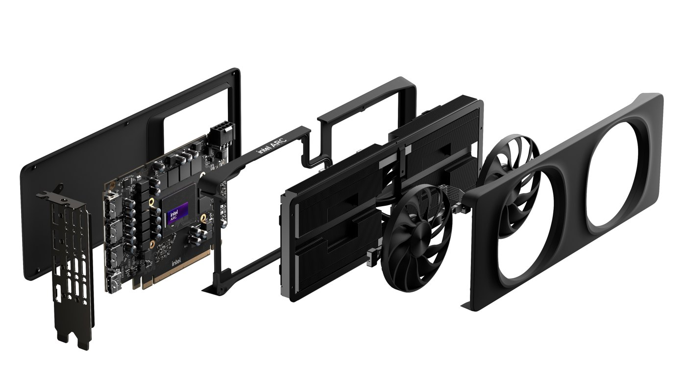
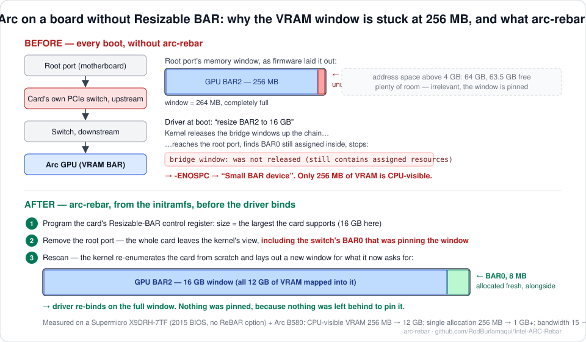

# arc-rebar — Resizable BAR for Intel Arc GPUs on firmware without ReBAR support

<p align="center">

</p>
<p align="center"><sub><em>arc-rebar is an independent community project, not affiliated with or endorsed by Intel.</em></sub></p>

<p align="center">
<a href="https://buymeacoffee.com/rodburlamaqui"></a>
<a href="https://buymeacoffee.com/rodburlamaqui/membership"></a>
</p>

**If arc-rebar helped bring your Intel Arc GPU back to life, or helped you in any way —**<br>
**please help keep the project moving.** Your contribution supports testing hardware, compatibility work, and ongoing maintenance.

Copyright (c) 2026 Rod Burlamaqui. Free for personal use; **commercial and enterprise use requires separate licensing** — see [LICENSE](LICENSE) §9.

> **USE AT YOUR OWN RISK. NO WARRANTY.** Provided "as is". The author accepts no
> liability for data loss, hardware damage, downtime or any other loss arising
> from its use. It writes one PCI register and re-enumerates one PCIe root port
> at boot; it is designed to have no effect rather than a harmful one, but that
> cannot be guaranteed on hardware the author has never seen. Read
> [DISCLAIMER.md](DISCLAIMER.md) in full before running anything. Back up first.

**What it is.** A boot-time tool that makes an Intel Arc discrete GPU expose its
full VRAM on motherboards whose BIOS has no Resizable BAR option — **without
modifying firmware, the kernel, or Intel's drivers**. It runs from the initramfs
at every boot, before the GPU driver loads, and it includes the diagnostics that
tell you whether you have the problem and prove the fix worked.

### Help keep arc-rebar moving

I've heard from users who thought their Intel Arc cards were stuck with serious
limitations or weren't worth keeping. Some have described arc-rebar as having
**saved their card or brought it back to life**. Getting real use out of
hardware that might otherwise sit idle is why I started this project.

What began as a fix for my own system has grown into something much bigger.
Every new GPU, motherboard, Linux platform, and community report means more
investigation, testing, fixes, and support. **It's becoming a full-time job**,
and I want to keep this project moving without cutting corners on safety or
compatibility testing.

If arc-rebar saved you from replacing a card, helped your system work again, or
simply made your hardware more useful, **please consider giving back**. Even a
small donation can help me keep working on it.

**[Support arc-rebar on Buy Me a Coffee](https://buymeacoffee.com/rodburlamaqui)**

<a href="https://buymeacoffee.com/rodburlamaqui"></a><br>
*Scan to support from your phone.*

**Want to support every month?**
**[Become a monthly supporter](https://buymeacoffee.com/rodburlamaqui/membership)**:
memberships start at **$5 a month**. Monthly support makes a real difference
and helps plan testing ahead.

Contributions help fund more Intel Arc GPUs and test systems, hardware
validation on additional platforms, bug investigations, community support,
releases, and documentation.

**Donate hardware.** We don't have every GPU and platform people run arc-rebar
on, and testing depends on community hardware. **What helps most:**

- **Graphics cards:** any Intel Arc model, Alchemist or Battlemage.
- **Motherboards:** especially boards without a Resizable BAR option, server
  boards and boards that can take two GPUs.

Complete systems and other test hardware are welcome too. We consider every
offer, but storage space is limited, so **please don't ship anything until we've
confirmed**. To offer something,
[open a hardware donation issue](https://github.com/RodBurlamaqui/Intel-ARC-Rebar/issues/new?template=hardware-donation.md)
describing the hardware only. **Please don't post your name, address or other
personal details in the issue.** To arrange shipping and other details
privately, email **burlam1nx@outlook.com** with your issue number.

**Supporters.** Thank you to everyone who supports arc-rebar with donations or
hardware. Supporters who'd like to be listed will be credited here, with their
permission.

Can't donate? Sharing the project, contributing detailed hardware reports,
and helping others troubleshoot are valuable too. Thank you to everyone who
has tested, reported issues, and helped this project grow.

*Donations support ongoing development; they do not change the project's
licensing terms or guarantee support for a particular hardware configuration.*

### Downloads

**Debian / Ubuntu: choose stable v1.0.5 for normal use.**

**Please consider [donating](https://buymeacoffee.com/rodburlamaqui) to keep this project alive.**

| Release | Use | Download | Notes and checksums |
|---|---|---|---|
| **v1.0.5 — stable** | Single GPU Support — Debian/Ubuntu | [Download `.deb`](https://github.com/RodBurlamaqui/Intel-ARC-Rebar/releases/download/v1.0.5/arc-rebar_1.0.5_all.deb) | [Release notes, source and SHA256SUMS](https://github.com/RodBurlamaqui/Intel-ARC-Rebar/releases/tag/v1.0.5) · [Install guide](INSTALL.md) |
| **v1.0.6 Experimental** | Dual GPU Support — Experimental Debian/Ubuntu | [Download experimental `.deb`](https://github.com/RodBurlamaqui/Intel-ARC-Rebar/releases/download/dual-a310-preview-2026.11.09.1/arc-rebar_1.0.6.dual-a3101_all.deb) | [Release notes and SHA256SUMS](https://github.com/RodBurlamaqui/Intel-ARC-Rebar/releases/tag/dual-a310-preview-2026.11.09.1) · [Required preflight, boot test and recovery guide](https://github.com/RodBurlamaqui/Intel-ARC-Rebar/blob/63364dcca2a98a32a8ee5b6efe88bed747e2e13d/docs/DUAL-A310-PREVIEW.md) |
| **v1.0.6 Experimental** | Dual GPU Support — Experimental Arch/CachyOS | [Download experimental source](https://github.com/RodBurlamaqui/Intel-ARC-Rebar/releases/download/dual-gpu-arch-preview-2026.11.09.1/arc-rebar-dual-gpu-arch-preview-2026.11.09.1.tar.gz) | [Release notes and SHA256SUMS](https://github.com/RodBurlamaqui/Intel-ARC-Rebar/releases/tag/dual-gpu-arch-preview-2026.11.09.1) · [Required Arch preflight, boot test and recovery guide](https://github.com/RodBurlamaqui/Intel-ARC-Rebar/blob/experimental/dual-a310/docs/DUAL-GPU-ARCH-PREVIEW.md) |
| **Arch/CachyOS — current source** | Single GPU Support — Experimental Arch/CachyOS (source only) | [Download current source](https://github.com/RodBurlamaqui/Intel-ARC-Rebar/archive/refs/heads/main.tar.gz) | Requires `--experimental-arch`; [install guide](INSTALL.md#arch-linux--cachyos-mkinitcpio) · [Hardware validation pending (#15)](https://github.com/RodBurlamaqui/Intel-ARC-Rebar/issues/15) |
| **v1.0.4 — previous** | Installer/purge recovery fixes; predates the v1.0.5 verifier correction | [Download `.deb`](https://github.com/RodBurlamaqui/Intel-ARC-Rebar/releases/download/v1.0.4/arc-rebar_1.0.4_all.deb) | [Release notes, source and SHA256SUMS](https://github.com/RodBurlamaqui/Intel-ARC-Rebar/releases/tag/v1.0.4) |
| **v1.0.3 — original release** | Historical package; lacks the newer installer/purge and verifier fixes | [Download `.deb`](https://github.com/RodBurlamaqui/Intel-ARC-Rebar/releases/download/v1.0.3/arc-rebar_1.0.3_all.deb) | [Release notes, source and SHA256SUMS](https://github.com/RodBurlamaqui/Intel-ARC-Rebar/releases/tag/v1.0.3) |

Both dual-GPU previews require an explicit boot opt-in and currently accept
exactly two non-console A310s on separate root ports, unbound or using VFIO.
**Physical two-card validation is pending on both platforms.** Follow the linked
preflight/test/recovery guide; the Debian preview's download commands also handle
GitHub's filename normalization for checksum verification. Report results in
[#3](https://github.com/RodBurlamaqui/Intel-ARC-Rebar/issues/3).

[Browse all releases and source archives](https://github.com/RodBurlamaqui/Intel-ARC-Rebar/releases),
including the historical Arch source preview. Arch/CachyOS is a separate
experimental source port; the **v1.0.5 `.deb` and source release do not include
the Arch installer**. Use the current source and its
[Arch/CachyOS install guide](INSTALL.md#arch-linux--cachyos-mkinitcpio).

### Community hardware reports

Developed and benchmarked on the **B580**, with community testing expanding
coverage to other Intel Arc cards. Thank you to everyone sharing results and
contributing ports. Here is the evidence reported so far:

| Card | Evidence | Current limits / source |
|---|---|---|
| **B580** | Original project hardware tests, reboots and Vulkan/OpenCL workloads on Supermicro X9DRH-7TF, Debian, `xe` | [Recorded tests](docs/TESTS.md); benchmarks below belong to this setup |
| **A750** | @TheKusja1 confirms a direct v1.0.3 → v1.0.5 package upgrade, 8 GiB BAR2 after reboot, `i915`, read-only WARN and successful Jellyfin AV1 hardware transcoding on Supermicro H11SSL-i / Proxmox | [Report #2](https://github.com/RodBurlamaqui/Intel-ARC-Rebar/issues/2) and [v1.0.5 hardware follow-up](https://github.com/RodBurlamaqui/Intel-ARC-Rebar/issues/2#issuecomment-6707332319); no AER reports or GPU hangs/resets observed in that run; the latch's physical age/cause remain unknown |
| **A310 4 GB — Proxmox / VFIO** | @optiz0r reports the first card resized from 256 MiB to 4 GiB on Fujitsu RX2540 M2; its full BAR is usable in the guest VM | [Report #3](https://github.com/RodBurlamaqui/Intel-ARC-Rebar/issues/3#issuecomment-6722498363) and [diagnostics](https://gist.github.com/optiz0r/7cd12c10d971fc3fcc8549abe4eb9731); boot log confirms the first-card resize; the second card remains at 256 MiB, so dual-GPU operation is not yet verified |
| **A770 / A750** | Reporter describes appropriate BAR sizes with a locally modified loop on Asus Z9PA-D8, Debian SID / `xe` | [Report #3](https://github.com/RodBurlamaqui/Intel-ARC-Rebar/issues/3#issuecomment-6649456377); unmodified diagnostics pending; upstream script still handles only the first qualifying GPU |
| **A380 — Debian / Lenovo** | Community reports an 8 GiB BAR, boot persistence and normal `i915` use on Lenovo ThinkCentre M900 / OpenMediaVault | [Report #10](https://github.com/RodBurlamaqui/Intel-ARC-Rebar/issues/10); legacy verifier failed on DevSta `0x0008`; v1.0.5 has a matching software test returning unresolved WARN; physical cause and hardware acceptance remain pending |
| **B580 — Proxmox / VFIO** | Community reports a 16 GiB BAR passed to Ubuntu from Dell PowerEdge R720, with working compute workloads | [Report #11](https://github.com/RodBurlamaqui/Intel-ARC-Rebar/issues/11); missing boot verdict and intermittent guest copy-engine faults remain unexplained |
| **A380 — Arch experimental** | Contributor reports CachyOS / `i915` image contents and dry-run topology checks for the experimental Arch port | [Original report #4](https://github.com/RodBurlamaqui/Intel-ARC-Rebar/pull/4), consolidated into [PR #6](https://github.com/RodBurlamaqui/Intel-ARC-Rebar/pull/6); real boot/workload validation tracked in [#15](https://github.com/RodBurlamaqui/Intel-ARC-Rebar/issues/15) |

**Two A310s? An experimental `.deb` is available:**
[download the two-A310 preview](https://github.com/RodBurlamaqui/Intel-ARC-Rebar/releases/tag/dual-a310-preview-2026.11.09.1).
It requires an explicit boot opt-in and exactly two non-console A310s on separate
root ports, unbound or using VFIO. **Physical two-card validation is pending.**
Start with the [read-only preflight, boot test and recovery guide](https://github.com/RodBurlamaqui/Intel-ARC-Rebar/blob/63364dcca2a98a32a8ee5b6efe88bed747e2e13d/docs/DUAL-A310-PREVIEW.md),
and report results in [#3](https://github.com/RodBurlamaqui/Intel-ARC-Rebar/issues/3).
Stable **v1.0.5** remains the normal download; other GPU models/counts are refused
by this preview. Thanks to @optiz0r for the A310 diagnostics and first-card result.

**Testing another model? Your report is welcome.** Additional Arc models may
qualify when the PCIe topology, ReBAR capability and MMIO checks pass. A model
name alone does not establish compatibility. Read the prerequisites and run
`diagnose` first; never force a refusal.
[Share a hardware report](https://github.com/RodBurlamaqui/Intel-ARC-Rebar/issues/new?template=hardware-report.md)
or read the [compatibility evidence and reporting guide](docs/COMPATIBILITY.md).

Community reports describe particular setups; they do not establish universal
support. Stars show interest in the project; compatibility comes from documented
hardware results. Arch/CachyOS support is **experimental and source-only**;
installation requires `sudo ./install.sh --experimental-arch`. It has software
integration coverage but no maintainer-verified physical Arch/GPU boot result.
[Hardware validation is tracked in #15](https://github.com/RodBurlamaqui/Intel-ARC-Rebar/issues/15).
The earlier [Arch preview](https://github.com/RodBurlamaqui/Intel-ARC-Rebar/releases/tag/arch-preview-2026.11.05.1)
remains an unchanged historical snapshot; its CLI predates this opt-in flag.
Use the current source for the gated installer. Multi-GPU operation remains an
open limitation.



<sub>Intel Arc B580 Limited Edition. Photo © Intel Corporation, from Intel's newsroom press kit for the Arc B-Series launch (Dec 2024), reproduced with credit. The photo is Intel's and is **not** covered by this project's licence.</sub>



**Tested on** a Supermicro X9DRH-7TF (Intel C602, two Xeon E5-2670 v2, AMI BIOS
3.2 from 2015 — no ReBAR option) with an Intel Arc B580 12 GB, Debian 13, kernel
7.1.8, `xe` driver. Persistent across reboots; the real boot log is below.

| | Before | After |
|---|---|---|
| CPU-visible VRAM (BAR2) | 256 MiB | 16 GiB window — all 12 GB of VRAM reachable |
| Vulkan device heap | 11.68 GiB device-only + a **256 MiB** host-visible scrap | **one 11.93 GiB** heap |
| Largest single OpenCL allocation | 256 MiB | 1 GiB (the runtime's own limit) |
| Measured VRAM bandwidth (saxpy) | 15 GB/s | 392 GB/s |
| 4K Vulkan filter (ffmpeg gblur) | stalls, 0 frames | 39–50 fps |
| Media encode/decode (VAAPI) | works | works (was never affected) |

---

## 1. Do you have this problem?

Your kernel log says so directly:

```
sudo dmesg | grep -E 'resize bar|Small BAR'
```
```
xe 0000:86:00.0: [drm] Attempting to resize bar from 256MiB -> 16384MiB
xe 0000:86:00.0: [drm] Failed to resize BAR2 to 16384MiB (-ENOSPC). Consider enabling 'Resizable BAR' support in your BIOS
xe 0000:86:00.0: [drm] Small BAR device
```

`Small BAR device` means only 256 MB of your VRAM is CPU-accessible. Any single
allocation over 256 MB fails; anything that streams data through that window
crawls. To see whether it is specifically the cause this tool fixes:

```
sudo dmesg | grep 'was not released'
```
```
pcieport 0000:80:03.0: bridge window [...]: was not released (still contains assigned resources)
```

That line is the signature. The tool's own check does all of this and more:

```
sudo arc-rebar diagnose          # from the .deb
sudo ./diagnose.sh               # from a source checkout
```

Its last line is one of: **`YES: pinned window, all safety checks pass`** (this tool
applies), `BAR already at full size` (you don't need it), or `NOT SAFE / NOT
APPLICABLE here: skip reason=...` (see §5).

## 2. What is actually wrong

It is not "your BIOS is too old" in the way that phrase suggests. Intel Arc cards
carry an **integrated PCIe switch** on the card. The switch's upstream port has
its own small BAR (8 MB), and firmware places it in the same prefetchable memory
window as the GPU's VRAM BAR:

```
root port          prefetchable window 264 MB   <-- pinned by the line below
 └ switch upstream   BAR0  8 MB                 <-- owned by pcieport, unused, never released
   └ switch downstream
     └ Arc GPU       BAR2  256 MB               <-- wants 16 GB
```

When the `xe` driver asks the kernel to enlarge BAR2, the kernel releases the
bridge *windows* up the chain — but never a bridge's *own BAR*. It reaches the
root port, finds the switch's BAR0 still assigned inside the window, refuses to
release it, and the 16 GB request has nowhere to go: `-ENOSPC`. Free address
space is irrelevant; the test machine had 63 GB free above 4 GB.

Intel's own engineers identified the same thing and posted a kernel quirk for it
("PCI: Release BAR0 of an integrated bridge to allow GPU BAR resize", 2025,
device IDs 0x4fa0 / 0x4fa1 / 0xe2ff). It stalled in review and is not in
mainline as of kernel 7.1. This tool does the equivalent from userspace.

Full investigation with every log line: [docs/ROOT-CAUSE.md](docs/ROOT-CAUSE.md).
Every test command with before/after numbers: [docs/TESTS.md](docs/TESTS.md).

## 3. What exactly it does

The boot script `scripts/init-premount/arc-rebar` runs once per boot from the
initramfs, after udev has enumerated PCI and before the root filesystem is
mounted. In order:

| Step | Action | Refuses / stops if |
|---|---|---|
| 0 | Read the kernel command line | `norebar` present → does nothing |
| 1 | **Find the GPU**: first PCI device with vendor `8086`, class VGA, and a Resizable BAR extended capability (or the one named by `rebar.dev=`) | none found → does nothing |
| 2 | **Find its root port**: the first hop below the host bridge in the GPU's sysfs path. Require the path to be exactly *root port → card switch upstream → card switch downstream → GPU* | deeper path (external switch, riser, Thunderbolt) → `skip unexpected-topology` |
| 3 | **Check the root port carries only this card**: every device beneath it must be Intel and be a bridge, the GPU, or the card's HDMI audio | anything else (an NVMe, a NIC…) → `skip shared-root-port` |
| 4 | **Read the card's ReBAR capability**: supported sizes bitmask and current size field. Target = the largest the card supports (or `rebar.size=`) | — |
| 5 | **Measure MMIO room** from `/proc/iomem`: the largest host-bridge window above 4 GB for this root bus. Step the target down until the BAR plus 64 MB fits (or 2× the BAR if the window start is unaligned) | no window above 4 GB → `skip no-mmio-window-above-4g`; nothing ≥ 512 MB fits → `skip mmio-window-too-small` |
| 6 | Compare current vs target | already at target → `none` (no-op; this is what a ReBAR-capable board looks like) |
| 7 | **Unbind** any driver already attached beneath the root port (`xe`, `snd_hda_intel`); `pcieport` is left alone | — |
| 8 | **Write the ReBAR control register** (`setpci … ECAP_REBAR+8.l`), setting only the size field to the target | write fails → `skip setpci-write-failed` |
| 9 | **Remove the root port** (`echo 1 > /sys/bus/pci/devices/<rootport>/remove`). This drops the whole card from the kernel's view — including the switch's BAR0 that was pinning the window | — |
| 10 | **Rescan** (`echo 1 > /sys/bus/pci/rescan`). The kernel re-enumerates the card from scratch. Because BAR2 now *advertises* the big size and nothing is pinned, it allocates BAR0 and the full-size BAR2 together into a fresh window. udev re-binds `xe`, which now sees the full aperture | — |
| 11 | **Verify** BAR2 got an address. If not, **roll back**: write the original size field, remove and rescan again, so the machine ends the boot on the old 256 MB rather than with no GPU | rollback also fails → `FAILED` (boot still continues; use `norebar`) |

Every exit path returns 0 — **boot is never failed**. The verdict is always in
the kernel log as `arc-rebar: PLAN: <verdict>`. `pci=realloc` on the kernel
command line is required so the rescan is allowed to size the bridge windows.

**What a fixed boot looks like** (real log from the test machine):

```
[    3.241] xe 0000:86:00.0: [drm] Attempting to resize bar from 256MiB -> 16384MiB
[    3.242] xe 0000:86:00.0: [drm] Failed to resize BAR2 to 16384MiB (-ENOSPC). Consider enabling 'Resizable BAR' support in your BIOS
[    3.244] xe 0000:86:00.0: [drm] Small BAR device                                   <-- xe's FIRST probe, before the fix
[    4.182] arc-rebar: gpu=0000:86:00.0 rootport=0000:80:03.0 cap=0x0007f000 ctl=0x00000822 size_field current=8 target=14
[    4.695] arc-rebar: unbound xe from 0000:86:00.0
[    5.753] arc-rebar: wrote ECAP_REBAR ctl=0x00000e22; removing 0000:80:03.0 and rescanning
[    7.861] xe 0000:86:00.0: [drm] VISIBLE VRAM: 0x0000381000000000, 0x0000000400000000   <-- re-probe on the 16G window
[   11.209] arc-rebar: PLAN: done gpu=0000:86:00.0 bar2=16384M
```

The `xe` driver loads from the initramfs *before* this script runs, so its first
attempt always fails and logs "Small BAR device" exactly as before — every boot.
That is expected. Judge by the later `VISIBLE VRAM` line, by `arc-rebar verify`,
and by `vulkaninfo`.

### What it changes on your system

Installing it touches exactly these things, all reversible:

| What | Where | Backup |
|---|---|---|
| The initramfs hook and the boot script | `/etc/initramfs-tools/hooks/arc-rebar`, `/etc/initramfs-tools/scripts/init-premount/arc-rebar` | — |
| Rebuilt initramfs | `/boot/initrd.img-<kernel>` | `/boot/initrd.img-<kernel>.arc-rebar.bak` |
| `pci=realloc` added to the kernel command line | `/etc/default/grub` | `/etc/default/grub.arc-rebar.bak` |
| A marker recording who installed the hook | `/var/lib/arc-rebar/hook-origin` | — |

Nothing else. No firmware, no BIOS settings, no driver files, no kernel modules.

### What it does not do

- It does not touch firmware or the BIOS. Nothing it writes survives a power cycle
  on the GPU side; the register is re-programmed at every boot.
- It does not make your VRAM bigger. A 12 GB card gets a 16 GB *window* because
  BAR sizes are powers of two and the card offers no 12 GB option; 12 GB is
  mapped into it and `vulkaninfo` shows ~11.9 GiB. The rest of the window points
  at nothing.
- It does not change the PCIe link speed. On the test board the card runs Gen3 x8
  because the *root port* is Gen3 — that is the platform's maximum.
- It does not fix the separate VAAPI `SIGBUS` crash the Intel media driver has on
  small-BAR cards. That is [arc-b580-vaapi-sigbus-fix](https://github.com/RodBurlamaqui/Intel-ARC-B580-vaapi-sigbus-fix) (§10).
- Updating the GPU's firmware is not an alternative to it. Tested on this card:
  FWCODE 21.1137 → 21.1182 and OptionROM 23.1051.0.0 → 23.1066.0.0 changed
  nothing — the BAR still comes up at 256 MB and the kernel resize still fails
  with `-ENOSPC`. The card already advertises the full 256MB..16GB range; the
  constraint is on the host side. See [docs/ROOT-CAUSE.md](docs/ROOT-CAUSE.md).

### Firmware versions tested

Every GPU firmware component was flashed to the newest version LVFS offers
(September 2026), then the full before/after invariant set was re-run across a
complete power cycle. Nothing about the BAR changed.

| Component | Before | After | Effect |
|---|---|---|---|
| FWCODE | `21.1137` | **`21.1182`** | none |
| OptionROM Code | `23.1051.0.0` | **`23.1066.0.0`** | none |
| FWDATA | `203.1` | `203.1` | LVFS offers no update |
| OptionROM Data | `23.1051.0.0` | `23.1051.0.0` | LVFS offers no update |
| GuC | `70.65.0` | `70.65.0` | none — ships in the host firmware package, not on the card |
| HuC | `8.2.10` | `8.2.10` | none — as above |

Cab `intel-arc-bmg-21.1180.cab`, sha256 `a4dedea0…5637`, LVFS releases 143096
(FWCODE) and 143112 (OPROMCODE). Two traps worth knowing: a single
`fwupdmgr update` against the **FWCODE** device flashes the **OptionROM too** —
both payloads ride in the same cab — and neither part reads as live until a full
power cycle, so a version check taken right after the write still shows the old
numbers.

The same flash was checked against all three known problems on this hardware:

| Problem | Fixed by the firmware? | Why not |
|---|---|---|
| BAR2 stuck at 256 MB, kernel resize fails `-ENOSPC` | **No** | the pin is a *host* bridge BAR0 inside the root port window. The card already advertises the full range — `cap = 0x0007f000`, identical before and after |
| VAAPI `SIGBUS` in `vaInitialize` | **No** | a bug in Intel's userspace media driver, not firmware — see [§10](#10-related-project) |
| Vulkan falls back to `llvmpipe` | **No** | OS configuration — the user is not in the `render` group |

Full evidence in [docs/ROOT-CAUSE.md](docs/ROOT-CAUSE.md).

## 4. Requirements

- Debian or Ubuntu with an active `initramfs-tools` backend. A dracut-backed
  `update-initramfs` is not supported by this installer, even if
  `/etc/initramfs-tools` exists. Draft Arch Linux / CachyOS support uses
  `mkinitcpio`; `install.sh` hands over to `install-arch.sh` on that layout.
  Kernel 6.12 or newer recommended (the `xe` driver's ReBAR support). `pciutils`.
- **Above 4G Decoding enabled in BIOS**, and an MMIO window above 4 GB at least
  as large as your VRAM rounded up to a power of two. `diagnose` checks this.
- The GPU directly in a slot on a root port of its own (no external PCIe switch,
  riser, or Thunderbolt in between). `diagnose` checks this.
- A second way into the machine (SSH) if you run the optional live test, which
  turns the local display off for about ten seconds.
- Other initramfs systems (dracut): the boot script is plain POSIX `sh` and needs
  only `setpci`; porting it is a Modification under the licence — ask first.
  mkinitcpio is already ported: see [INSTALL.md](INSTALL.md#arch-linux--cachyos-mkinitcpio).

### Recommended BIOS settings

Every board names these settings differently, and not every board has all of
them. The names below are the ones our community reports used. Check your
board's manual for the exact wording. arc-rebar never changes BIOS settings
itself.

**The settings**

| Setting (common names) | Set to | Why | Needed for |
|---|---|---|---|
| **Above 4G Decoding**: "Memory Mapped I/O above 4GB" (Dell), "64-bit MMIO", "Above 4G memory" (MSI) | **Enabled** | Gives the BIOS address space above 4 GB for a large BAR. Without it arc-rebar refuses: `skip reason=no-mmio-window-above-4g`. | **Everyone** |
| **Resizable BAR / Re-Size BAR Support** | **Enabled, if your BIOS has it** | If the BIOS already resizes the BAR, the card boots at its maximum and arc-rebar does nothing (`none reason=already-at-target`). You probably don't need arc-rebar at all. | Boards that have it |
| **Secure Boot** | **Disabled on Ubuntu** (see note) | Ubuntu's kernel turns on *lockdown* when Secure Boot is on, and lockdown blocks the PCI register write arc-rebar depends on. The BAR then stays at its original size. | Ubuntu; check other distros |
| **Primary / boot display**: "Primary Graphics Adapter" (ASRock), "onboard graphics" | **Onboard video**, if the board has it | Required for the dual-GPU preview, which refuses a GPU that drives the console. On servers it also keeps a console if the Arc card has a problem. | Dual-GPU preview; recommended on servers |
| **VT-d / IOMMU** (Intel), **AMD-Vi / IOMMU** (AMD) | **Enabled only for VM passthrough** | Needed for Proxmox/VFIO passthrough. arc-rebar itself doesn't use it. | Proxmox / VFIO |
| **SR-IOV** | **Only if you use SR-IOV virtual functions** | arc-rebar doesn't use it. SR-IOV with Arc Pro cards is still being investigated in [#3](https://github.com/RodBurlamaqui/Intel-ARC-Rebar/issues/3). | SR-IOV users |
| **64-bit MMIO size / base**, if your BIOS has such an option | **Larger** | If arc-rebar steps the BAR size down (`note: MMIO window is ...`) or refuses with `mmio-window-too-small`, a larger 64-bit MMIO area can fit the full BAR. | Only if you hit those messages |
| **CSM / Legacy boot** | **Disabled (UEFI boot)** if you use the BIOS's own Resizable BAR | Intel lists CSM off and UEFI boot as a requirement for firmware Resizable BAR ([Intel](https://www.intel.com/content/www/us/en/support/articles/000090831/graphics.html)). arc-rebar itself does not check boot mode. | Firmware ReBAR users |
| **PCIe link speed**: "PCIE1 Link Speed", "PCIe Link Speed", per-slot speed | **Set it explicitly** to the generation your platform supports (e.g. **Gen3** on Gen3 servers, **Gen4** on Gen4 boards), **not Auto** | Maintainer experience: Auto has caused link problems, and ASRock notes its Auto mode "is optimizing for overclocking" ([ASRock BIOS guide](https://download.asrock.com/Manual/Software/Intel%20B760/Software_BIOS%20Setup%20Guide_English.pdf)). The Arc card's own link is PCIe 4.0 capable (16 GT/s on the A750 in [#28](https://github.com/RodBurlamaqui/Intel-ARC-Rebar/issues/28)); every server in our reports with link data so far runs it at Gen3 (8 GT/s). If errors persist, go one generation lower. | **Everyone** with the option |
| **ASPM**: "Native ASPM", "PCI Express root port ASPM", "L1 Substates" | **Enabled** for low idle power; **Disabled** while troubleshooting link errors | Intel recommends Native ASPM and root-port ASPM L1 for Arc idle power ([Intel](https://www.intel.com/content/www/us/en/support/articles/000092564/graphics.html)). arc-rebar doesn't use it. | Optional |
| **Slot bifurcation**: "x16 / x8x8 / x4x4x4x4" | **Auto / x16** for the GPU's slot | Splitting the slot is not needed. arc-rebar requires the GPU to be alone on its root port and refuses otherwise (`skip shared-root-port`). | Only if you changed it |

**Secure Boot note:** verified on Ubuntu's `7.0.0-43-generic` kernel, which is
built with `CONFIG_LOCK_DOWN_IN_SECURE_BOOT=y`. Other distributions may do the
same. To check any system, run `cat /sys/kernel/security/lockdown`: if the
selected value (in brackets) is `[integrity]` or `[confidentiality]`, arc-rebar
cannot resize the BAR. **In v1.0.5 and earlier**, the boot script then still
logs `PLAN: done` with the *old* size (for example `bar2=256M`), because
`setpci` does not report the refused write; `sudo arc-rebar verify` shows the
real BAR size. The fix is on `main` and will ship in the next release: it
refuses up front with `skip reason=kernel-lockdown` (which `diagnose` also
reports), or `skip reason=rebar-write-not-applied` if the write did not take
effect.

**If Above 4G Decoding is missing or greyed out:** some boards only offer it
when booting in UEFI mode. Check your manual.

**Watch out for the integrated-graphics "Aperture Size":** on ASRock Intel
700-series boards, Above 4G Decoding "is disabled automatically when Aperture
Size is set to 2048MB" ([ASRock BIOS guide](https://download.asrock.com/Manual/Software/Intel%20B760/Software_BIOS%20Setup%20Guide_English.pdf),
Chipset Configuration). Don't set Aperture Size to 2048MB.

**Where to find these settings.** Names and menus vary by vendor, model and
BIOS version. On ASRock Intel boards most of them are under **Advanced >
Chipset Configuration**; ASUS Intel boards have a **System Agent (SA)
Configuration** menu. What we could confirm:

| Vendor | Above 4G | Resizable BAR | Primary display | GPU slot link speed | ASPM | Source |
|---|---|---|---|---|---|---|
| **ASRock** (Intel 700-series) | Advanced > Chipset Configuration > "Above 4G Decoding" | "C.A.M (Clever Access Memory)" | "Primary Graphics Adapter" [Auto] [Onboard] [PCIE1] | "PCIE1 Link Speed" [Auto] [Gen1]...[Gen5] | "PCIE ASPM Support", "PCH PCIE ASPM Support", "DMI ASPM Support" | [Official BIOS guide](https://download.asrock.com/Manual/Software/Intel%20B760/Software_BIOS%20Setup%20Guide_English.pdf) |
| **MSI** (Z790) | "Above 4G memory" | "Re-Size BAR Support" | Not confirmed | A per-slot "Max Link Speed" option (Gen1 to Gen5) | Not confirmed | Manual excerpts (MEG Z790 series); check your manual |
| **ASUS** (Z790) | Not confirmed | Not confirmed | Not confirmed | Not confirmed | "PEG - ASPM" | Manual excerpts (ROG Z790 series: a "System Agent (SA) Configuration" menu exists); check your manual |
| **Dell PowerEdge** (R720, T430, R740) | "Memory Mapped I/O above 4GB" | No option reported on any of the three. A Dell community response says Resizable BAR is offered only on Dell client products (XPS, Alienware) ([Dell community](https://www.dell.com/community/en/conversations/rack-servers/dell-r740xd-bar-support-for-gpu/67c22faa6bb97c48ad18df9d)) | Not confirmed | Not confirmed | Not confirmed | Community reports (#11, #28, #3) |
| **Intel's generic names** | "Above 4G Decoding" | "Re-Size BAR Support" | Not covered | Not covered | "Native ASPM", "PCI Express root port ASPM", "L1 Substates" | [Intel](https://www.intel.com/content/www/us/en/support/articles/000090831/graphics.html), [Intel ASPM](https://www.intel.com/content/www/us/en/support/articles/000092564/graphics.html) |

**PCIe errors (any setting above can be involved):** in community and
maintainer experience, some boards and slots, especially with risers, long
traces or two GPUs, produce PCIe errors at their highest link speed. Signs: `verify` reports `FAIL` on PCIe error reports or
DevSta, the kernel log shows `AER:` / `PCIe Bus Error:` lines, or a server's
management log (iDRAC, iLO, IPMI SEL) shows a "bus fatal error". A common
troubleshooting step, from community and maintainer experience rather than
Intel guidance, is to set that slot's **PCIe link speed** explicitly instead of
Auto, then one generation lower if errors continue (for example Gen4 to Gen3),
and to disable **ASPM** while testing. Change one setting at a time.

**Servers can reset without any Linux log.** Many servers handle PCIe errors in
firmware ("firmware-first"). A fatal error can make the firmware reset the
whole machine before Linux writes anything, so check the management log
(iDRAC / iLO / IPMI SEL) for the slot and bus it names. That log, not the
Linux log, was the key evidence in
[#28](https://github.com/RodBurlamaqui/Intel-ARC-Rebar/issues/28).

**Kernel command line (not BIOS, but related):** `pci=realloc` is required. Do
not add `pci=nocrs`: with it, the kernel ignores the BIOS address windows and
arc-rebar refuses with `skip reason=no-mmio-window-above-4g`, even when Above 4G
Decoding is on.

**By setup**

| Your setup | What to set | Community examples |
|---|---|---|
| One Arc card, **BIOS has a Resizable BAR option** | Above 4G Decoding **on**, Resizable BAR **on** | arc-rebar is likely not needed |
| One Arc card, **no Resizable BAR option** (most older desktops, workstations and servers) | Above 4G Decoding **on**. On Ubuntu, Secure Boot **off**. Then install arc-rebar | Supermicro X9DRH-7TF (maintainer), Lenovo ThinkCentre M900 ([#10](https://github.com/RodBurlamaqui/Intel-ARC-Rebar/issues/10)) |
| Server with onboard video, Arc used for compute or transcoding | As above, plus primary display on **onboard video** | Fujitsu RX2540 M2 ([#3](https://github.com/RodBurlamaqui/Intel-ARC-Rebar/issues/3)) |
| **Proxmox / VFIO passthrough** to a VM | As above, plus **VT-d / IOMMU on**. Install arc-rebar on the **Proxmox host**, not in the VM | Dell PowerEdge R720 ([#11](https://github.com/RodBurlamaqui/Intel-ARC-Rebar/issues/11)), Fujitsu RX2540 M2 ([#3](https://github.com/RodBurlamaqui/Intel-ARC-Rebar/issues/3)) |
| **Two GPUs** (v1.0.6 Experimental, two A310s only) | As above, plus primary display on **onboard video**. Neither Arc card may drive the console, and each card needs its own root port | Fujitsu RX2540 M2, 2x A310 ([#3](https://github.com/RodBurlamaqui/Intel-ARC-Rebar/issues/3)) |
| **SR-IOV** (e.g. Arc Pro B50) | No recommendation yet | Under investigation in [#3](https://github.com/RodBurlamaqui/Intel-ARC-Rebar/issues/3) |

**If the boot log says...**

| Boot log message | Most likely cause | What to check |
|---|---|---|
| `skip reason=no-mmio-window-above-4g` | No address space above 4 GB, or `pci=nocrs` hides it | **Above 4G Decoding** in BIOS, or remove `pci=nocrs` from the kernel command line. After v1.0.5 the message says which |
| `skip reason=mmio-window-too-small` or `note: MMIO window is ..., stepping target down` | The 64-bit MMIO area is too small for the full BAR | A **64-bit MMIO size** option in BIOS, if available, or a smaller `rebar.size` (see [INSTALL.md](INSTALL.md)) |
| `skip reason=kernel-lockdown` or `skip reason=rebar-write-not-applied` (after v1.0.5) | Kernel lockdown blocks the write, often because **Secure Boot** is on | **Secure Boot** in BIOS, and `cat /sys/kernel/security/lockdown` |
| v1.0.5 and earlier: `PLAN: done` but with the **original** size (e.g. `bar2=256M`), and `verify` shows the BAR still small | Same as above: the write was refused but not reported | **Secure Boot** in BIOS, and `cat /sys/kernel/security/lockdown` |
| `skip reason=no-pci-realloc` | `pci=realloc` is missing | The kernel command line, not BIOS |

## 5. Where it applies — and where it refuses

`diagnose` runs the boot script's own checks in dry-run mode and reports what it
*would* do. The installer refuses unless that answer is "act".

| Situation | Verdict |
|---|---|
| Intel Arc (Battlemage or Alchemist) directly in a slot, small BAR, room above 4 GB | **acts** — the case it fixes |
| Firmware already supports ReBAR / BAR already at maximum | `none` — no-op |
| No Intel GPU with a ReBAR capability (AMD, NVIDIA, Intel iGPU) | `none` — no-op |
| GPU behind an external switch, riser, or Thunderbolt | `skip unexpected-topology` |
| Other devices share the GPU's root port | `skip shared-root-port` |
| No MMIO window above 4 GB (Above 4G Decoding off, or `pci=nocrs` on the kernel command line) | `skip no-mmio-window-above-4g`; after v1.0.5 the hint names `pci=nocrs` when that is the cause |
| Window above 4 GB too small for even 512 MB | `skip mmio-window-too-small` |
| Window fits a smaller BAR than the card's maximum | **acts with the smaller size**, logs the step-down |
| BAR2 unassigned after the rescan | **rolls back** to the original size; `rolled-back` |
| `norebar` on the kernel command line | `skip norebar` |
| Kernel lockdown active (often Secure Boot), seen in `/sys/kernel/security/lockdown` | `skip kernel-lockdown`, before any change (after v1.0.5) |
| The ReBAR write did not take effect (register unchanged after the rescan), e.g. lockdown not yet visible at boot | `skip rebar-write-not-applied`; BAR stays at its original size (after v1.0.5) |
| Register changed but BAR2 came back at the wrong size | **rolls back** to the original size; `rolled-back` (after v1.0.5) |

Maintainer hardware validation covers the B580 setup above. Community Alchemist
reports and their limits are listed in [Community hardware reports](#community-hardware-reports).
The MMIO-too-small, no-window and step-down checks were also exercised against
faked `/proc/iomem` files. The shared-root-port, unexpected-topology and
rolled-back paths were reviewed, not hardware-tested. More model/platform
reports are welcome; unreported combinations remain unverified.

## 6. Install

Full step-by-step with the exact output you should see at every step, and what
to do if you don't: **[INSTALL.md](INSTALL.md)**. The short form:

**Current Debian/Ubuntu package: 1.0.5**, containing read-only PCIe verification
and the installer/purge recovery fixes. [Version 1.0.3](https://github.com/RodBurlamaqui/Intel-ARC-Rebar/releases/tag/v1.0.3)
remains downloadable with its original assets and checksums; it lacks those fixes.
The experimental Arch source port is separate and requires `--experimental-arch`.
Published Debian/Ubuntu packages do not include the Arch installer.

**Debian / Ubuntu, from the `.deb`** — download it from the [Releases](https://github.com/RodBurlamaqui/Intel-ARC-Rebar/releases) page, or:

```
wget https://github.com/RodBurlamaqui/Intel-ARC-Rebar/releases/latest/download/arc-rebar_1.0.5_all.deb
wget https://github.com/RodBurlamaqui/Intel-ARC-Rebar/releases/latest/download/SHA256SUMS
```
```
sha256sum -c --ignore-missing SHA256SUMS         # must print: arc-rebar_1.0.5_all.deb: OK
```
```
sudo apt install ./arc-rebar_1.0.5_all.deb    # step 0: installs the tool; ENABLES NOTHING
```
```
sudo arc-rebar diagnose                         # step 1: last line must be "YES: pinned window, all safety checks pass"
```
```
sudo arc-rebar install                          # step 2: pre-checks, plan, type ACCEPT, backup, install, post-checks
```
```
sudo reboot                                     # step 3
```
```
sudo arc-rebar verify                           # step 4, after reboot: review PASS / WARN / FAIL
```

**From source:**

```
git clone https://github.com/RodBurlamaqui/Intel-ARC-Rebar.git
cd Intel-ARC-Rebar
```
```
sudo ./diagnose.sh          # step 1: last line must be "YES: pinned window, all safety checks pass"
```
```
sudo ./install.sh           # step 2: pre-checks, plan, type ACCEPT, backup, install, post-checks
```
```
sudo reboot                 # step 3
```
```
sudo ./verify.sh            # step 4, after reboot: review PASS / WARN / FAIL
```

**Cautious path** (recommended on a board nobody has tried): prove it live
before enabling it at boot. `sudo arc-rebar prepare` adds `pci=realloc` only;
reboot; `sudo arc-rebar live-test` runs the fix once over SSH with nothing
persistent changed; then install as above. Two reboots total. INSTALL.md
Path B covers it.

The installer: runs the environment and hardware pre-checks → shows the plan →
prints the licence and disclaimer and requires you to type `ACCEPT` → backs up
the initramfs and GRUB config → installs → verifies every piece is inside the
rebuilt initramfs, restoring the backup if not.

## 7. After it is installed

Every boot: the hook runs, fixes the BAR, `xe` re-binds on the full window —
about 8 seconds on the test machine. Check any time with:

```
sudo arc-rebar verify
```
Example output for a single B580 (your addresses and sizes will differ):

```
== arc-rebar verify (boot 2026-11-10 09:00:00) ==
  [ok]   pci=realloc active
  [ok]   hook installed
  [ok]   no PCIe error reports in available kernel log
  [ok]   boot verdict: done gpu=0000:86:00.0 bar2=16384M
  [ok]   0000:86:00.0 BAR2 = 16384 MiB (size field 14 = card maximum)
  [ok]   0000:86:00.0 driver: xe
  [ok]   0000:86:00.0 DevSta snapshot: 0x0000
  [ok]   xe last probe VISIBLE VRAM: 0x0000381000000000, 0x0000000400000000
  [ok]   no PCIe error reports in available kernel log
  [warn] Driver binding/BAR allocation do not establish GPU workload health.

RESULT: PASS
```

The `[warn]` line about workload health always appears; it is a reminder, not
a problem. If `vulkaninfo` is installed, a `vulkan: memoryHeaps ...` line
follows it. See [PCIe status](#pcie-status) below for what `WARN` and `FAIL`
mean.

### PCIe status

`verify` separates BAR allocation/driver binding from PCIe status evidence.
A bound driver or successful transcode alone does not prove GPU memory/compute
health. Verification is read-only and never clears status or writes PCI
configuration registers.

| Evidence | Result / exit |
|---|---|
| Existing checks pass, endpoint DevSta clean | PASS / 0 (checks only, not a workload certification) |
| Only correctable / Unsupported Request DevSta bits (0/3) latched | WARN / 2 (age/cause unresolved) |
| Nonfatal/fatal DevSta bits (1/2), PCIe log reports, failed allocation/driver checks, invalid/unreadable registers or kernel log | FAIL / 1 |

Run `sudo arc-rebar verify` and preserve the output alongside relevant
`sudo arc-rebar diagnose`, `sudo lspci -Dvv` and kernel-log evidence locally.
Review and redact machine identifiers, network addresses and unrelated logs
before sharing an excerpt publicly. A warning is a request to investigate;
it does not establish that a latched event is harmless, historical or caused
by ReBAR. Automation must handle exit 2 separately from success and failure.

Endpoint status is a snapshot, not a complete upstream AER audit. Kernel-log
matching retains a conservative system-wide failure policy and can include
unrelated devices. Missing boot-verdict messages are reported as warnings;
a PASS covers only checks with available evidence, not proof of this hook's
execution or guest GPU workload health.

The optional register-clearing experiment is preserved separately on
[`experimental/pcie-clear-recheck`](https://github.com/RodBurlamaqui/Intel-ARC-Rebar/tree/experimental/pcie-clear-recheck)
at commit `c6f78cbb1639fdc5451c4850179dc43f0d93cfe6`. It is excluded from the
stable verifier and still lacks physical GPU validation. The stable CLI rejects
`--recheck-pcie` with exit 64 before reading hardware.
See [the evidence and validation limits](docs/VERIFY-PCIE.md).

## 8. Diagnostics

`diag/` is the read-only half of this app: it tells you what is going on before
you change anything and proves the change afterwards. Full detail in
[diag/README.md](diag/README.md) and [diag/INSTALL.md](diag/INSTALL.md).

| Command | What it tells you |
|---|---|
| `sudo arc-rebar diag bar-pin-check` | BAR2 size vs card maximum, the root port window, **which bridge BAR0 pins it**, MMIO room, the kernel's signature line, a verdict |
| `sudo arc-rebar diag pcie-link-truth` | which PCIe link is physical. The GPU function itself reports a *virtual* 2.5 GT/s x1 port — a trap; the real link is the card's upstream port |
| `arc-rebar diag vulkan-heaps` | a separate 256 MiB device-local heap = small BAR; one merged heap = full aperture |
| `arc-rebar diag ocl-alloc-ceiling` | the real single-allocation ceiling, by allocating for real (`clinfo` reports the wrong number), then total usable VRAM in chunks and measured bandwidth |
| `sudo arc-rebar diag gpu-health` | PCIe error bits, AER reports, hangs/resets, temperatures, clocks, throttle reasons |

From a source checkout: `diag/bin/<tool>.sh`; build the allocator with `make -C diag`.
Run them before and after to capture your own before/after numbers.

## 9. Safety, escape hatch, knobs

- **Escape hatch:** at the GRUB menu press `e`, append `norebar` to the `linux`
  line, boot. The script then does nothing and you are on the old 256 MB BAR.
- **Never fails a boot.** Every failure path logs and continues.
- **No-op when not needed.** If firmware or a future kernel ever enlarges the BAR
  itself, the script sees "already at target" and exits.
- **Rollback.** If the new BAR cannot be placed, it restores the old size rather
  than leaving the GPU without an address.
- Kernel command-line knobs: `norebar`; `rebar.dev=0000:86:00.0` to choose a GPU;
  `rebar.size=N` to force a size field (2^(N+20) bytes: 14 = 16 GB, 13 = 8 GB, 12 = 4 GB).
- Known realistic failure modes and what to do — including the possibility of a
  hang at the rescan on chipsets that dislike root-port re-enumeration (power
  cycle; nothing persistent changed on a live test) — are in
  [DISCLAIMER.md](DISCLAIMER.md) and the troubleshooting section of [INSTALL.md](INSTALL.md).

## 10. Related project

**[Intel-ARC-B580-vaapi-sigbus-fix](https://github.com/RodBurlamaqui/Intel-ARC-B580-vaapi-sigbus-fix)**
— the other half of the story on the same hardware. Before the BAR could be
enlarged, Intel's media driver crashed outright (`SIGBUS` in `vaInitialize`) on
any small-BAR card; that project backports Intel's upstream fix into a Debian 13
`.deb`. It stops the crash; arc-rebar removes the cause. Keep both installed:
the patched driver is harmless on a full aperture and necessary if this fix is
ever disabled.

## 11. Uninstall

```
sudo apt purge arc-rebar        # .deb: removes the tool AND the boot hook — but only if the .deb installed the hook
sudo ./uninstall.sh             # source checkout
```

`apt remove` (without purge) removes the tool and deliberately leaves an enabled
boot hook in place. Both leave `pci=realloc` in GRUB; it is harmless. To revert
it:

```
sudo cp /etc/default/grub.arc-rebar.bak /etc/default/grub
```
```
sudo update-grub
```

## 12. Repository layout

```
scripts/init-premount/arc-rebar   the boot-time fix (POSIX sh, self-checking)
hooks/arc-rebar                   initramfs-tools hook: ships setpci into the initramfs
diagnose.sh  prepare.sh  live-test.sh  install.sh  verify.sh  uninstall.sh
bin/arc-rebar                     the `arc-rebar` command (installed by the .deb)
diag/                             diagnostics: bin/ (five tools), src/ocl_test.c, Makefile, README, INSTALL
debian/  build-deb.sh             .deb build inputs and the script that builds it
docs/img/intel-arc-b580-press.jpg  Intel's press photo of the card (© Intel Corporation, credited; not under this licence)
docs/img/arc-rebar-pin.svg        the mechanism diagram (original artwork)
docs/ROOT-CAUSE.md                the full investigation, with the kernel log evidence
docs/TESTS.md                     every test command used, with before/after numbers
INSTALL.md  DISCLAIMER.md  LICENSE  CHANGELOG.md
```

## 13. Contributing

Bug reports are welcome — open an issue with the output of `sudo arc-rebar
diagnose` and `sudo dmesg | grep -E 'arc-rebar|was not released|Small BAR'`.
`journalctl -k -b` can omit userspace `/dev/kmsg` boot-script messages. Review
diagnostics and redact private details before sharing them.
Modifications and ports require the copyright holder's prior written approval
(LICENSE §3.2): open an issue describing the change before writing it.

## 14. Licence

Copyright (c) 2026 Rod Burlamaqui. Licensed, not sold, under the arc-rebar
Software License Agreement in [LICENSE](LICENSE):

- **Personal Use** — free of charge for private, non-commercial use by an individual.
- **Commercial and enterprise use — separate licensing required.** Any use by or
  for a business, institution, hardware or software vendor, or in providing services
  to others, and any incorporation of this code into another product, driver,
  firmware, kernel or package, requires a separate written commercial licence
  (LICENSE §3.1, §9). Enquiries welcome, including from GPU and platform vendors —
  email [burlam1nx@outlook.com](mailto:burlam1nx@outlook.com) (LICENSE §9.4).
- **Previews follow the same terms.** Experimental, beta, alpha and other
  pre-release versions do not exempt Commercial Use from the written licence
  requirement; free Personal Use remains governed by LICENSE §2.1.
- **Modification** — no derivative works, ports or modified distributions without
  prior written approval. Bug reports and proposed changes are welcome.
- **Resale** — no sale, sublicensing or distribution for payment without approval.
  Free redistribution of complete, unmodified copies is permitted.
- **No warranty** — see LICENSE §5–6 and [DISCLAIMER.md](DISCLAIMER.md).

Not an open-source licence. The B580 product photo in `docs/img/` is © Intel
Corporation (Intel newsroom press kit) and is excluded from this licence. The
underlying technique — programming the ReBAR
control register and re-enumerating the root port — is not claimed; it was first
published by andersevenrud for a Supermicro H11SSL-i. This licence covers this
implementation only.

## 15. Credits

- @andersevenrud — the setpci + remove/rescan method, in a [gist for the H11SSL-i + B580](https://gist.github.com/andersevenrud/eec93e9151117bc0d6b6133b40eaffa5).
- @hrimfaxi — the original Arch/CachyOS mkinitcpio port and A380 image/dry-run
  checks in [#4](https://github.com/RodBurlamaqui/Intel-ARC-Rebar/pull/4), preserved
  in [#6](https://github.com/RodBurlamaqui/Intel-ARC-Rebar/pull/6); runtime validation continues
  in [#15](https://github.com/RodBurlamaqui/Intel-ARC-Rebar/issues/15).
- @TheKusja1 — the detailed A750/i915 boot, workload and PCIe-status report in
  [#2](https://github.com/RodBurlamaqui/Intel-ARC-Rebar/issues/2).
- @optiz0r — hardware-testing contributor: A310 first-card 4 GiB BAR and guest
  access confirmation, detailed Proxmox/VFIO diagnostics and separate-root
  topology in [#3](https://github.com/RodBurlamaqui/Intel-ARC-Rebar/issues/3#issuecomment-6722498363),
  and the first two-A310 result with the v1.0.6 Experimental preview: both cards
  at 4 GiB and a model spanning both ([#3](https://github.com/RodBurlamaqui/Intel-ARC-Rebar/issues/3#issuecomment-6738373908)).
- @ThatGuy-Bob — A770/A750 results and the multi-GPU limitation report in
  [#3](https://github.com/RodBurlamaqui/Intel-ARC-Rebar/issues/3).
- @jacl3 — the A380/Lenovo ThinkCentre M900 boot and verifier report in
  [#10](https://github.com/RodBurlamaqui/Intel-ARC-Rebar/issues/10).
- @CelluloidRacer2 — the B580/Dell R720 VFIO, workload and limitation report in
  [#11](https://github.com/RodBurlamaqui/Intel-ARC-Rebar/issues/11).
- @meshuggah27 — the A750/Dell PowerEdge T430 Proxmox/VFIO report with iDRAC,
  slot-map and PCIe diagnostics in [#28](https://github.com/RodBurlamaqui/Intel-ARC-Rebar/issues/28).
- @desiwko — Arc Pro B50 pair on a Dell PowerEdge R740 (Proxmox, SR-IOV):
  diagnostics and dual-preview preflight in [#3](https://github.com/RodBurlamaqui/Intel-ARC-Rebar/issues/3).
- @LukeImYourFasia — dual B580 on a Dell Precision 5820: diagnostics,
  dual-preview preflight and suspend/resume testing in [#3](https://github.com/RodBurlamaqui/Intel-ARC-Rebar/issues/3).
- Ilpo Järvinen and Lucas De Marchi (Intel) — the kernel-side analysis and the
  stalled quirk that confirmed the mechanism.
- The kernel's own log line, `was not released (still contains assigned
  resources)`, which was the whole answer once someone read it.
